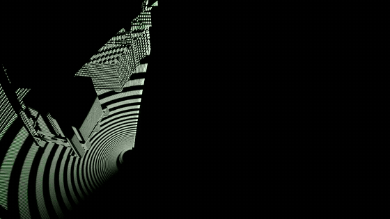
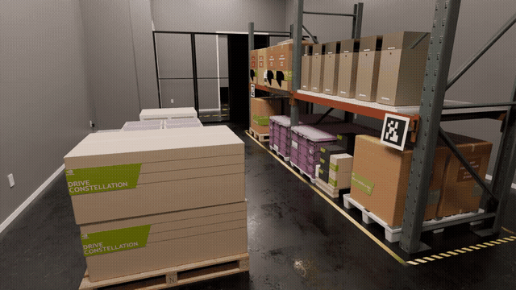
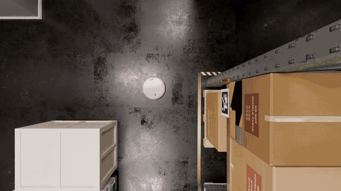
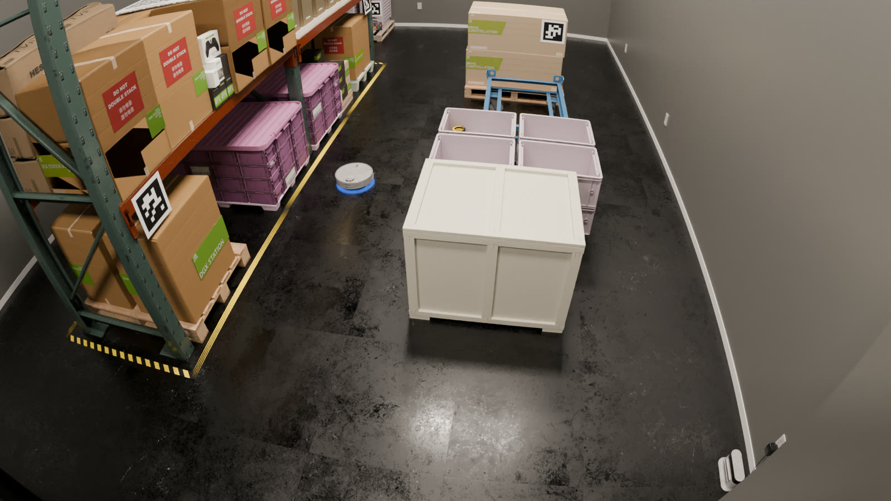
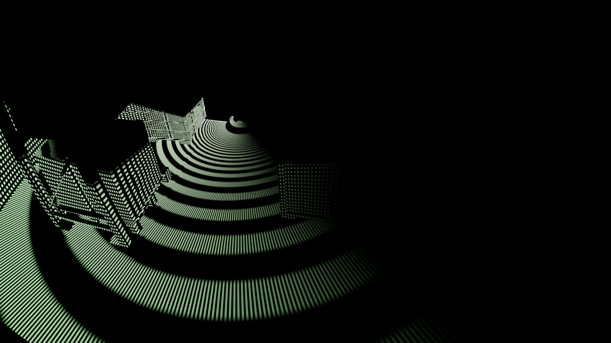
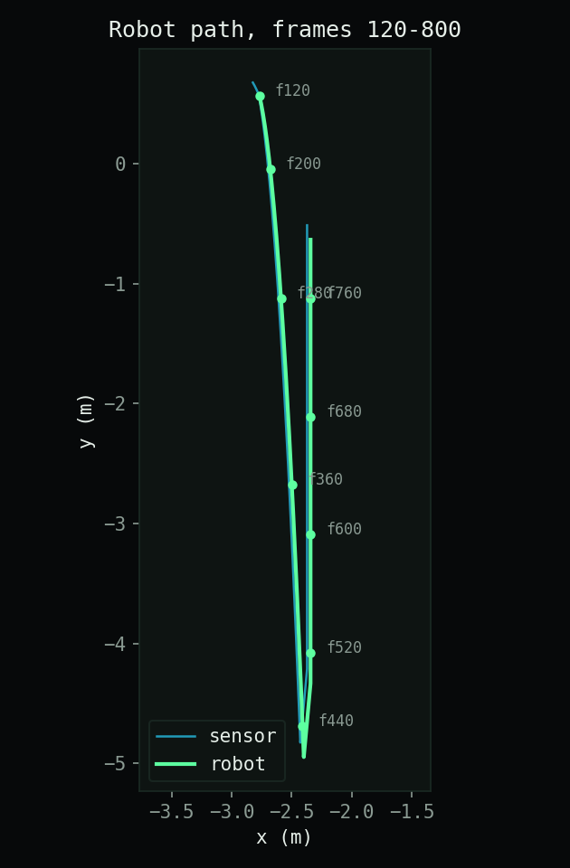
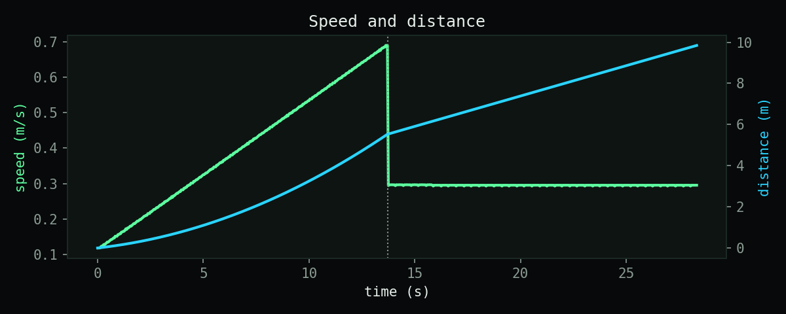

# Isaac Warehouse LiDAR demo

NVIDIA Isaac Sim **Digital Twin Warehouse** exported to **Blender 5.0**, with an animated LiDAR sensor on a robot vacuum. Rendered in Cycles.

**Live page:** https://pro2004-a11.github.io/isaac-warehouse-lidar/




*Aisle camera, beauty, frames 120-800*


*Top-down follow, robot path*

Full-quality clips: [aisle](docs/media/aisle.mp4) · [top-down follow](docs/media/topdown.mp4) · [room LiDAR](docs/media/lidar_room.mp4) · [sensor LiDAR](docs/media/sensor_lidar.mp4) · [sensor beauty](docs/media/sensor_beauty.mp4)

## Same scene, two views

| Beauty, frame 300 | LiDAR layer, frame 300 |
|---|---|
|  |  |

## Robot path and speed





<br clear="left">

| Metric | Value |
|---|---|
| Frames | 120-800 @ 24 fps (28.3 s) |
| Path length | 9.84 m |
| Mean / max speed | 0.35 / 0.69 m/s |
| Route extent | 5.51 m (Y) x 0.43 m (X) |
| Reversal | frame 449 at y = -4.95 m, instant (0.69 to 0.29 m/s in one frame), return at 0.29 m/s |
| Total heading change | 12.9 deg |

The reversal is an animation keyframe step, not a physical turn. Per-frame data: [`data/robot_path.csv`](data/robot_path.csv), [`data/metrics.json`](data/metrics.json).

## LiDAR sensor model

A procedural shader (`LiDAR Wave` node group in the `LiDAR_Pass` material, forced on a dedicated `LiDAR` view layer), not ray-cast geometry. Values in [`data/lidar_params.json`](data/lidar_params.json).

| Parameter | Value |
|---|---|
| Returns | 480 azimuth x 40 elevation |
| Max range | 14 m (fade from 4 m) |
| Vertical FOV | +14 / -38 deg |
| Beam width / trail | 2.5 deg / 140 deg |
| Scan camera | fisheye equisolid, 21 mm, 1920 x 1920 source |
| Mount | parented to robot, 0.12 m off centre, 0.05 m up |

## Scene

1,919 objects, 1.40 M triangles, 132 materials (101 converted from MDL: 63 textured, 38 constants, 15 left as authored), 106 images, 6 lights, 5 AprilTags (ids 14, 15, 16, 18, 19).

## Pipeline

1. **Flatten USD** - `tools/usd_flatten_collect.py` flattens `World0.usd` (Isaac Sim 5.0) to `warehouse.usdc` and collects textures (88 collected, 0 copy failures).
2. **Read MDL** - `tools/mdl_parse.py` extracts texture paths and parameters from Omniverse MDL.
3. **Map to Blender** - `tools/material_spec.py` classifies each material into a template (73 omni_pbr, 12 constant, 5 ue4_basic, 5 ue4_mask_lerp, 3 ue4_desat_tint, 2 ue4_color_mask4, 1 ue4_emissive); `tools/base_materials.py` builds the Principled BSDF graph.
4. **Import and patch** - `tools/blender_import.py` or the `addon/isaac_usd_importer` extension; `data/overrides.json` patches what USD cannot supply (chain-link fence opacity).
5. **Verify** - `tools/verify_export.py`, `tools/render_check.py`.
6. **Robot and sensor** - animated robot vacuum, `LiDAR_Sensor` empty parented to it, fisheye `Scan_Camera`.
7. **Scan look** - second view layer with the LiDAR material override.
8. **Render** - Cycles + OptiX denoise on an RTX 4070 Ti; clips use every 8th frame (12 fps) at 12 samples, then ffmpeg to MP4/GIF.

## Honest scope

A Blender render of the Isaac warehouse with a LiDAR *visualisation*. Not an Isaac Sim sensor run, no point-cloud output. **No SLAM was run**; `data/robot_path.csv` is the ground-truth path a SLAM test could be scored against. 54 source textures lived on an Omniverse Nucleus server and were not localised, so those materials fall back to constants.

## Not in this repo

`.blend` and `.usdc` files (55 MB and 42 MB) and NVIDIA's warehouse assets and textures, which keep NVIDIA's licence.

## Reproduce

```
blender -b warehouse2_Lidar.blend --python tools/extract_run_data.py -- data/_raw.json
python tools/compute_metrics.py            # robot_path.csv, metrics.json, lidar_params.json
blender -b warehouse2_Lidar.blend --python tools/render_media.py -- frames 8 12
python tools/encode_media.py frames 12     # MP4s and GIFs into docs/media
python tools/build_page.py                 # docs/index.html
python tools/check_site.py                 # CI link check
```

The `.blend` is not in this repo (see above), so these need your own copy of the scene.

## Licence

Code: MIT, see [LICENSE](LICENSE). NVIDIA assets are not covered.
